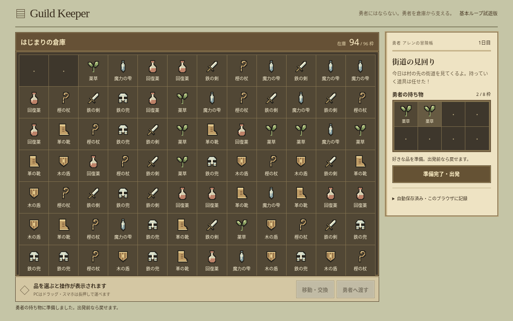
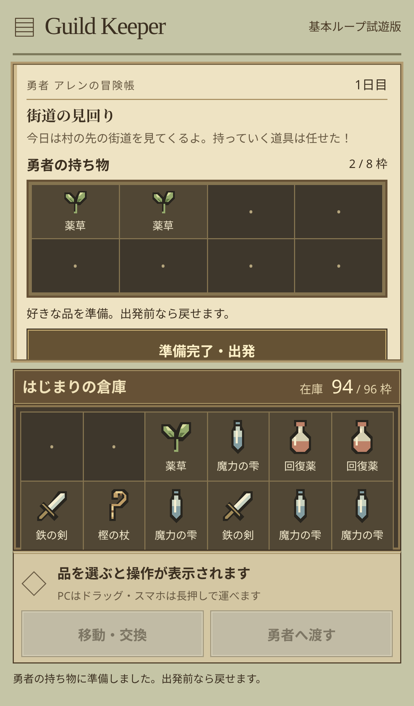
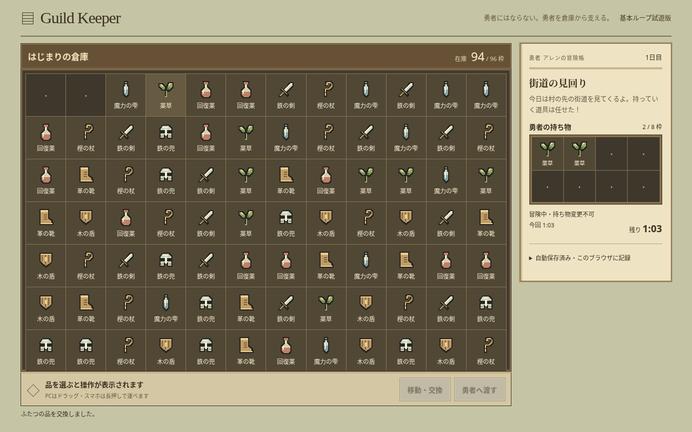
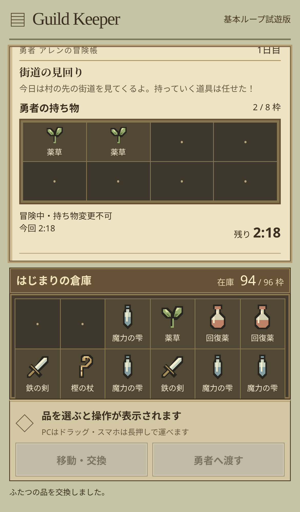

# 自由支給と冒険時間の画面確認

基本ループ再設計の実装ブランチをChromiumで確認した記録です。初期96枠・8品目と独自SVG、木の収納盤・羊皮紙の冒険帳を維持しています。画像はレビュー専用で、アプリからは読み込みません。

| 状態 | PC 1280×800 | スマホ 390×664 |
| --- | --- | --- |
| 出発前・自由支給 |  |  |
| 冒険中・倉庫整理後 |  |  |

- 勇者の8枠、出発前の取り戻し、出発後の持ち物固定、所要時間と残り時間を表示します。スマホの冒険帳は内部スクロールできます。
- 320×568、390×664、1280×800で横あふれ・ページの縦あふれがなく、44px以上の枠と下端の操作帯を確認。小画面でも倉庫の内部スクロール領域を64px以上確保しています。
- PCの標準ドラッグ、Chromiumの実際のタッチ入力による長押しドラッグ、通常スクロール、端の自動スクロール、タップだけの一連の操作をE2Eで検証しました。
- 人による発見性・待ち時間の楽しさと、実機iOS/Safariは未検証です。F-035のチェックを技術検証だけで完了にしません。
