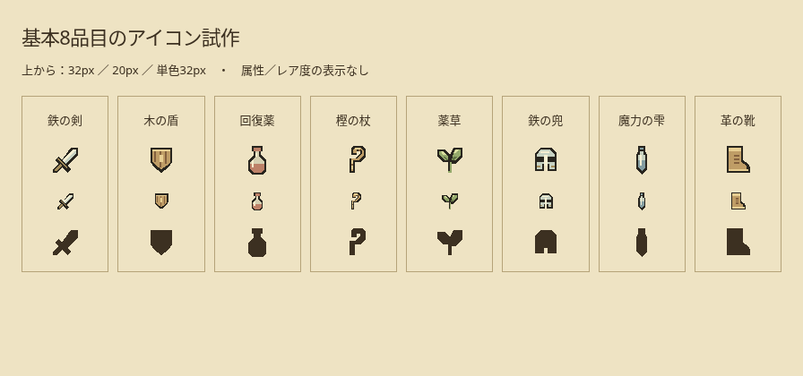
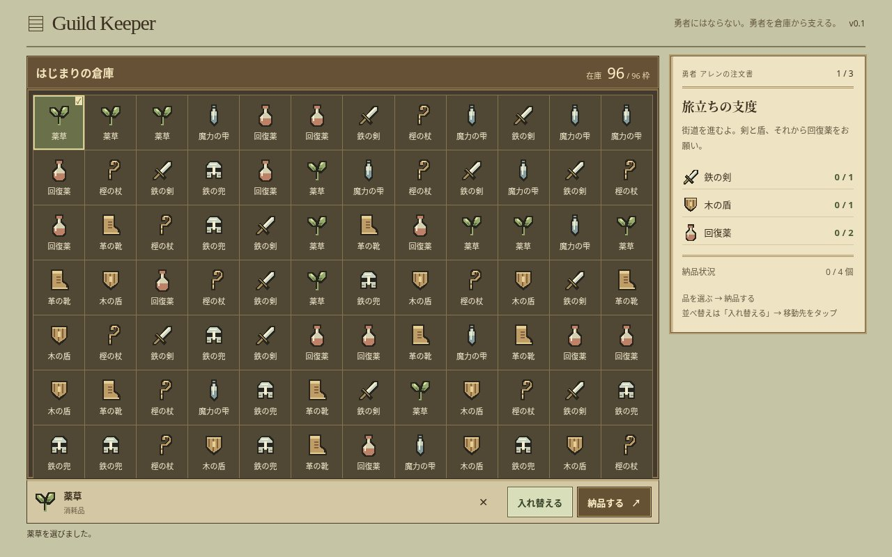
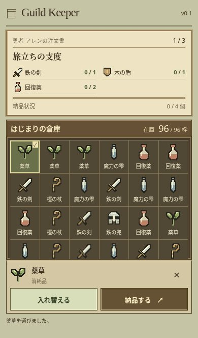

# 独自アイコンと倉庫 UI の試作レビュー

## 意図と企画資料

「勇者にはならない。勇者を倉庫から支える。」という企画を軸に、8品目の記号を中心としたゲーム画面へ再設計しています。色替えだけでなく、個別の角丸カードを連続した収納盤へ、選択欄を下端の操作帯へ統一しました。

Notion の原ページは環境制限で取得できませんでした。その後ユーザーから提供された2026-10-22の企画整理本文を読み、方向性合意・検討中・未採用案を区別して文書へ統合しています。未取得の内容を推測していません。競合調査の評価は提供資料の仮説として扱い、独立した市場再調査とはしていません。

今回の参考は、ユーザーが挙げたモンスターハンターのアイテムボックスに見られる「小さな輪郭と色・記号による情報整理」という考え方です。商用作品のアイコン・画面・素材を複製・トレースせず、16×16の図形を新規に作りました。

## 基本8品目の試作

- 倉庫・注文書・選択欄で同一の `ItemIcon` SVG を使用。輪郭・本体・明部・材質アクセントの4色を分け、形状を複製せずパレットを変えられる方式です。
- 現行の色は材質・品目の表現であり、属性・レア度ではありません。星や架空の情報を追加していません。
- この画像はブラウザ内で同じ SVG を32px・20px・単色に描画したレビュー用資料です。ゲームに単色切替やアイコン図鑑を追加したものではありません。
- 最終的な識別性・好みのプレイヤーレビューは未実施。F-004 のチェックは今回入れていません。

## PC：1280×800

| 変更前 | 変更後 |
| --- | --- |
|  |  |

## スマホ：390×664

| 変更前 | 変更後 |
| --- | --- |
|  |  |

変更前は main `6fa13e5`、変更後はこの PR。いずれも最初の注文、96個の在庫、スロット1の薬草を選択しています。タイトルは Guild Keeper を維持しています。

## 倉庫表示領域（内側、CSS px）

| 画面サイズ | 変更前 | 変更後 |
| --- | --- | --- |
| 1280×800 | 877×505 | 905×559 |
| 390×664 | 364×223 | 364×240 |
| 320×568 | 294×127 | 294×144 |

名札・注文帳・操作帯を整理し、装飾による領域の縮小を避けました。96セルと既存の最小幅を維持しています。

## 確認結果

- Lint・本番ビルド、既存のゲームロジックテスト8件が成功。
- Chromium E2E は既存4件に共通アイコンの確認を加え、PC・スマホ計6件成功。選択、交換、誤納品、全注文の納品、空き枠移動、注文遷移、リプレイを確認。
- 96個の倉庫アイコンが SVG であり、全8品目が異なる形状を持ち、注文・選択欄も対応する同じ図形になることを確認。
- 320×568、390×664、760×600、820×390、1280×800、640×400で、横あふれと品名の欠けがなく、アイテム枠が44px以上であることを確認。
- ゲームロジック、初期データ、注文、依存関係、Pages、既存の機能 ID とチェック状態は変更していません。スキル・設備・報告書等も未実装のままです。
- 実機 iOS／Safari、人による楽しさ・最終的なアイコン識別評価は未検証です。

比較画像はレビュー専用です。アプリから読み込まず、本番成果物には含めません。情報解放順、属性の色・印、レア度の星数、正式なアートの完成基準は未決定事項として残しています。
