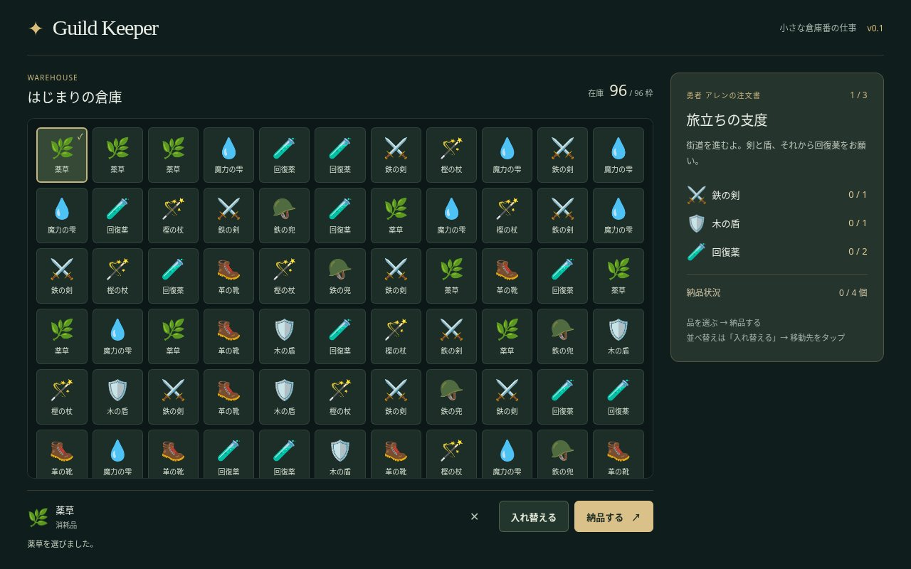
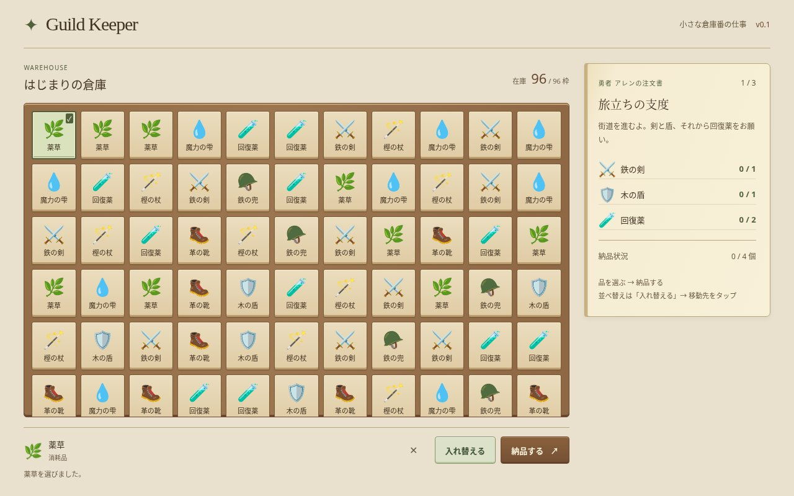
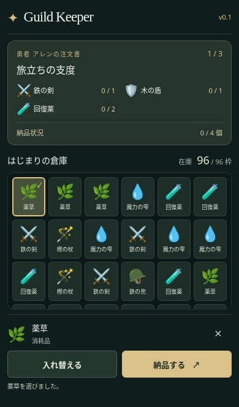
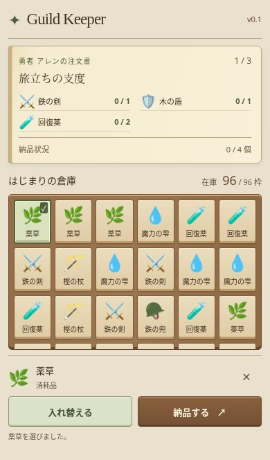

# 村のギルド倉庫：デザイン比較

変更前は `main` の `ba30b8e`、変更後はこのリデザイン PR の画面です。同じ初期在庫96個・注文1件目で、スロット1の薬草を選んだ状態を Chromium で撮影しています。

## PC（1280×800）

| 変更前 | 変更後 |
| --- | --- |
|  |  |

## スマホ（390×664）

| 変更前 | 変更後 |
| --- | --- |
|  |  |

## 確認結果

| 画面サイズ | 倉庫表示枠：変更前 → 変更後（CSS px） |
| --- | --- |
| 1280×800 | 879.2×507 → 879.2×507 |
| 390×664 | 366×224 → 366×225 |
| 320×568 | 296×128 → 296×129 |

- CSS の素材感に置き換え、倉庫の表示領域と列の最小幅を維持しています。見出し書体の差によりスマホの倉庫高は1px増えています。
- 320×568、390×664、760×600、820×390、1280×800、640×400 で横スクロール・品名の欠けがなく、44px以上のアイテム枠とキーボードフォーカスを確認しました。短い画面では既存のページスクロールへの切り替えを維持します。
- 既存のロジックテスト8件、Chromium の PC・スマホ E2E 4件、Lint・ビルドを確認。選択・入れ替え・全注文への納品・注文遷移・リプレイは同じ操作です。
- 実機 iOS / Safari は未検証です。画面の絵文字・ローカル書体は端末により変わります。

比較画像4枚はレビュー専用の JPEG（合計約328KiB）です。`public` やアプリの import に含めず、ゲームの配信データには追加しません。
